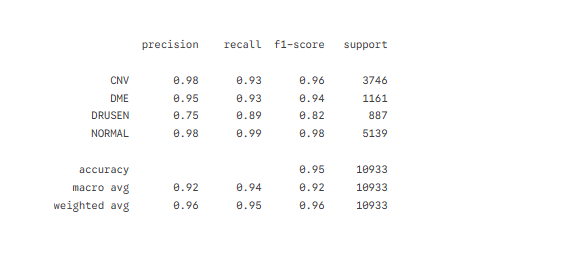
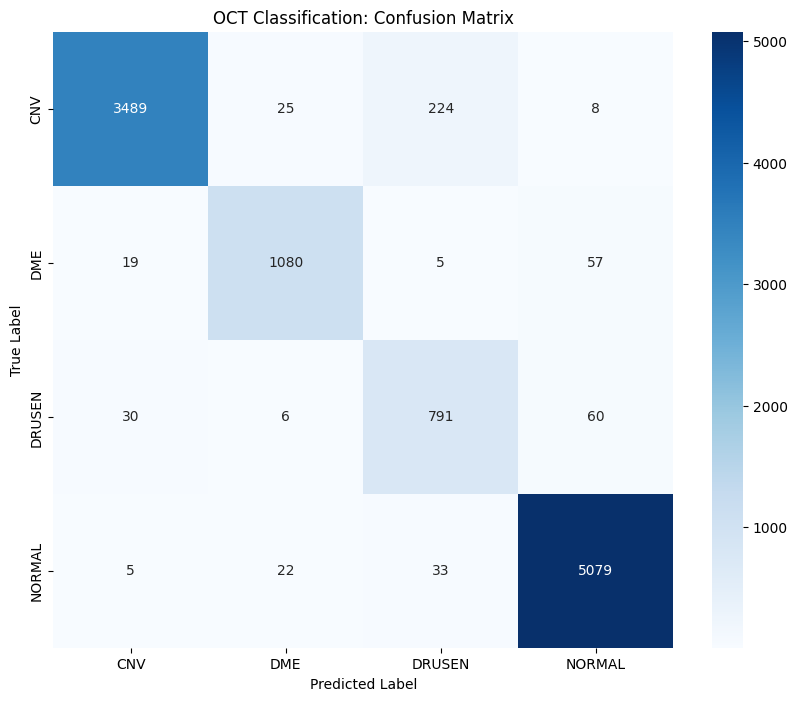
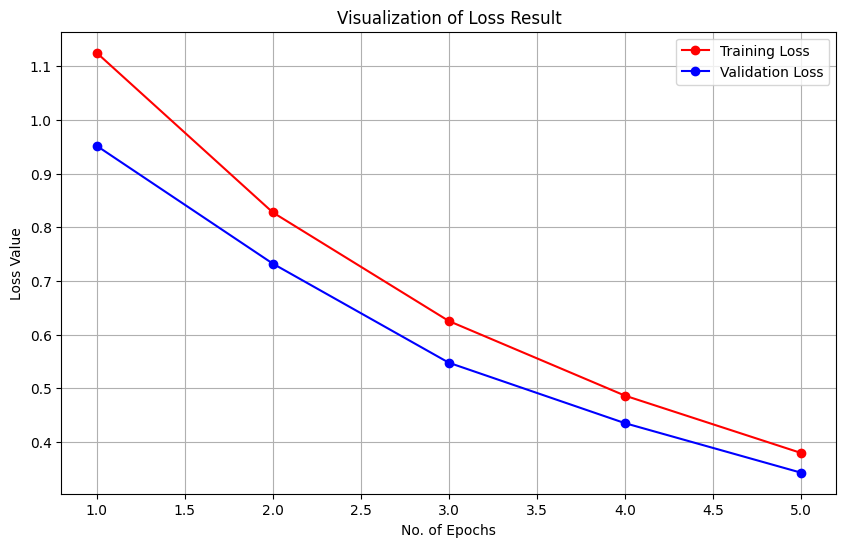
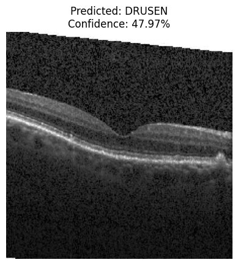

# 👁️ Retinal OCT Eye Disease Detection Using Deep Learning

A deep learning medical image classification system trained to detect and classify retinal diseases from Optical Coherence Tomography (OCT) scans across four diagnostic categories: **CNV** (Choroidal Neovascularization), **DME** (Diabetic Macular Edema), **DRUSEN**, and **NORMAL**.

---

## 🚀 Key Features
* **Transfer Learning Architecture:** Built using **MobileNetV3Large** as the backbone feature extractor with a custom dense classification head (`5.5M+` total parameters).
* **Multi-Class Retinal OCT Classification:** Automatically distinguishes healthy retinas (`NORMAL`) from three critical ocular pathologies (`CNV`, `DME`, and `DRUSEN`).
* **High Evaluation Performance (95% Overall Accuracy):** Evaluated across **10,933** unseen test scans, achieving a **0.96 weighted F1-score** and **0.98 F1-score** on `NORMAL` cases.
* **Smooth Training Convergence:** Training and validation loss curves show steady optimization across 5 epochs without overfitting.

---

## 📂 Dataset & Structure
The model is trained and evaluated on the official **Retinal OCT Images (Kermany et al.)** dataset sourced from Kaggle. The dataset is partitioned into three distinct subdirectories:
* **`train/`**: Used for model training and weight optimization via backpropagation.
* **`val/`**: Used during training epochs to monitor loss, evaluate convergence, and prevent overfitting.
* **`test/`**: Completely held-out set consisting of 10,933 scans used for final quantitative evaluation.

*Dataset Source:* [Kaggle - Retinal OCT Dataset](https://www.kaggle.com/datasets/paultimothymooney/kermany2018)

---

## 📈 Quantitative Evaluation Metrics

| Class | Precision | Recall | F1-Score | Support (Test Images) |
| :--- | :---: | :---: | :---: | :---: |
| **CNV** | 0.98 | 0.93 | 0.96 | 3,746 |
| **DME** | 0.95 | 0.93 | 0.94 | 1,161 |
| **DRUSEN** | 0.75 | 0.89 | 0.82 | 887 |
| **NORMAL** | 0.98 | 0.99 | 0.98 | 5,139 |
| **Overall Accuracy** | — | — | **0.95** | **10,933** |
| **Macro Avg** | 0.92 | 0.94 | 0.92 | 10,933 |
| **Weighted Avg** | **0.96** | **0.95** | **0.96** | **10,933** |

---

## 📊 Model Performance & Visuals

### 1. Classification Report
Per-class precision, recall, and F1-scores across 10,933 test samples:


### 2. OCT Classification Confusion Matrix
Visualizes true vs. predicted counts across all four retinal categories:


### 3. Training & Validation Loss Curve
Demonstrates steady loss reduction across 5 training epochs:


### 4. Sample Model Inference
Single-scan prediction output showing predicted class (`DRUSEN`) and model confidence score (`47.97%`):


---

## 🛠️ Project Structure
```text
eye-disease-detection/
├── assets/
│   ├── classification_report.png    # Precision, recall, and F1-score metrics
│   ├── confusion_matrix.png         # 4-class OCT test set confusion matrix
│   ├── loss_curve.png               # Training vs. validation loss plot
│   └── sample_prediction_image.png  # Single-scan inference output
├── notebooks/
│   └── eye_disease_detection.ipynb  # Complete Kaggle training & evaluation notebook
├── .gitignore
├── README.md
└── requirements.txt